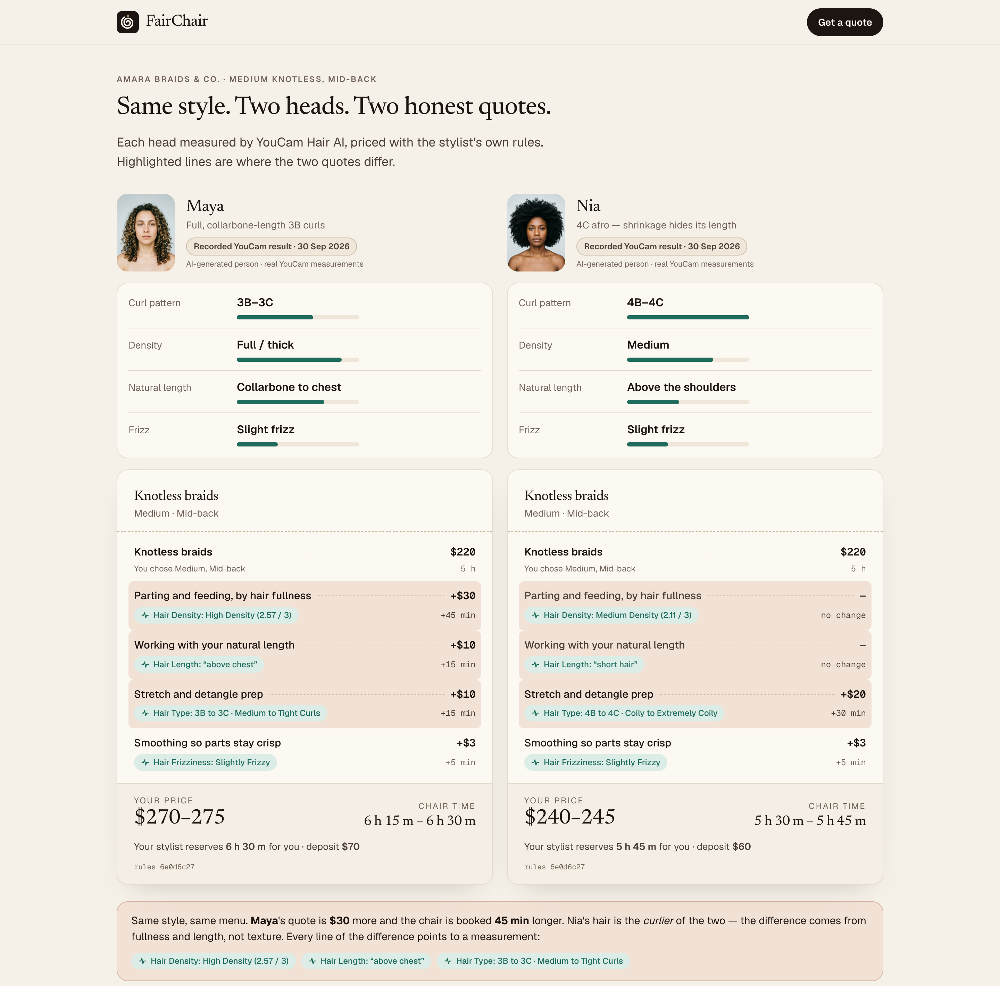
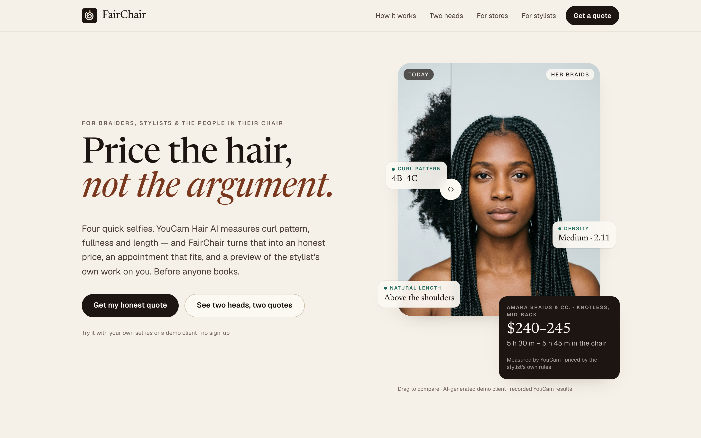
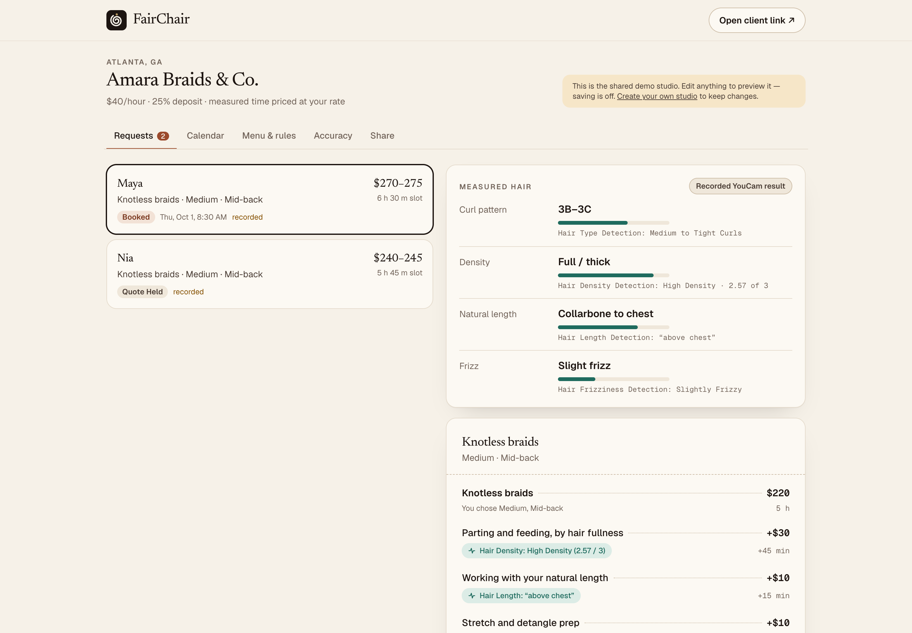
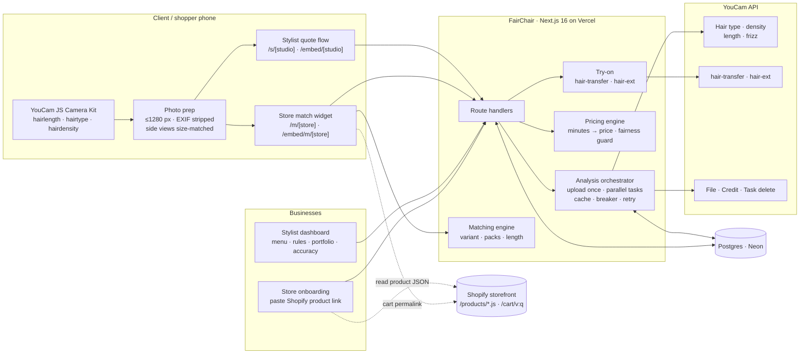

<p align="center">
  
</p>

<h1 align="center">FairChair</h1>

<p align="center"><strong>Honest quotes for textured hair, measured before anyone books.</strong></p>

FairChair uses YouCam's hair type, density, length and frizz detection to turn four guided selfies into decisions that are usually guessed from a blurry DM:

- **For braiders and extension stylists:** a line-item price, an appointment as long as the hair actually needs, a supply list, and a try-on of the stylist's own work.
- **For hair-extension stores:** "Find my match" picks the right texture, length and pack count from the store's own Shopify product, previews it blended into the shopper's hair, and hands off to checkout.

Built for the [YouCam API Skin AI & eCommerce VTO Hackathon](https://youcam-api-skin-ai-ecommerce.devpost.com/). Live: **https://fairchair.vercel.app**

<p align="center">
  
</p>

<p align="center">
  
  
</p>

---

## The problem

Independent braiders publish "Knotless, mid-back: from $220" and then quote from a blurry DM selfie at 11 pm. The things that change the price and the time, **how long, how full, how coily and how frizzy the client's natural hair is**, are listed in every braider's FAQ and measured by nobody. On the day, fuller and longer hair means two extra hours, a "$50 more" conversation at the chair, and the next client waiting. Existing quote tools still make someone *type* the hair in.

Extension shoppers face the same unknowns before checkout: which texture blends, what length (curly hair wears shorter), how many packs. Opened hair can't be returned.

## What FairChair does

### For stylists: `/s/<studio>`
1. **Measure.** Four guided selfies (YouCam Camera Kit, or upload). YouCam reads curl pattern, density, natural length and frizz.
2. **Price.** The stylist's own menu and hourly rate turn measured differences into minutes of chair time and a price range. Every line says which measurement caused it.
3. **See it.** The client previews the stylist's own portfolio photo on themselves (YouCam hair try-on) before any deposit.
4. **Agree.** Only start times that fit the whole appointment are offered; both sides keep the same hashed receipt.
5. **Learn.** After each appointment the stylist logs the real time; FairChair shows which of *their* rules is consistently off.

**Fair by design:** texture changes *time*, never the *rate*. A flat "+$25 for 4C" is a texture surcharge; FairChair won't apply it and offers the time-based equivalent.

**The one-screen demo:** *Same style. Two heads. Two honest quotes.* With real YouCam results, the curlier client is **not** the more expensive one; the fuller head is.

### For extension stores: `/m/<store>` (embeddable)
1. The shopper picks a length and their colour family, then takes the same guided selfies.
2. Texture ← curl pattern · packs ← density · length ← wanted length + shrinkage allowance for curly/coily hair. Every choice shows its reason.
3. YouCam hair-extension try-on shows added length blended into the shopper's **own** texture.
4. **Add to cart** opens the store's own Shopify checkout with the matched variant and pack count (`/cart/<variant>:<qty>`).

Merchants connect by pasting a product link: FairChair reads the public product JSON (`/products/<handle>.js`), so no Shopify app is needed, and the widget goes in with one Custom Liquid block. See the demo storefront at `/store-demo`.

## How YouCam is used

| Decision FairChair makes | YouCam capability | Endpoint / module |
|---|---|---|
| Prep time; extension texture | AI Hair Type Detection (1 → 4c) | `POST /s2s/v2.0/task/hair-type-detection` (front, right, left) |
| Parting time; pack count | AI Hair Density Detection (0–3) | `POST /s2s/v2.0/task/hair-density-detection` (chin-down) |
| Length tier; length to order | AI Hair Length Detection (8 bands) | `POST /s2s/v2.0/task/hair-length-detection` (step-back or front) |
| Smoothing time | AI Hair Frizziness Detection | `POST /s2s/v2.0/task/hair-frizziness-detection` (front, right, left) |
| Try the stylist's own work on the client | AI Hairstyle (hair-transfer v2.1, custom reference) | `POST /s2s/v2.1/task/hair-transfer` |
| Preview extensions in the shopper's texture | AI Hair Extension | `POST /s2s/v2.0/task/hair-ext` |
| Guided capture with live framing/angle/light checks | **JS Camera Kit** v2.5: `hairlength`, `hairtype`, `hairdensity` modes | `plugins-media.makeupar.com/v2.5-camera-kit/sdk.js` |
| Upload, balance, privacy clean-up | File, Credit, Task delete | `POST /s2s/v2.0/file`, `GET /s2s/v1.0/client/credit`, `POST /s2s/v2.0/task/delete` |
| Demo assets (AI-generated people, product photo) | AI Image Generator, image-to-image | `/s2s/v2.0/task/text-to-image/youcam` |

**Tested and deliberately excluded:** `skin-tone-analysis` → `hair_color` labelled black hair "Blonde" on 2 of 4 portraits (both dark hair on dark skin), so shade is the shopper's choice, never auto-selected. See [`docs/measurements.md`](docs/measurements.md).

Integration details (the API key never reaches the browser):
- Photos resized on the phone (≤1280 px, EXIF stripped, side views fitted to the front photo's exact size as the detectors require), uploaded once per view via presigned URLs; detectors run **in parallel**; stateless polling (serverless-safe).
- **Result cache** by image hash per feature; **credit circuit-breaker** and per-device daily cap; one retry on transient engine errors (errors cost no units).
- `task/delete` only after **all** tasks finish (deleting early also deletes shared input photos, which we found in live testing).
- Try-on images are returned to the browser and never stored.
- Demo clients replay **recorded live YouCam responses**, always labelled.

Live-API findings (accuracy, determinism, latency, doc/SDK mismatches, the colour decision, production limits) are in [`docs/measurements.md`](docs/measurements.md).

## Architecture



The sequence of one live quote and the full design are in [`docs/architecture.md`](docs/architecture.md).

## Try it

| What | Where |
|---|---|
| Two heads, two quotes | `/compare` |
| Client quote (live selfies or demo clients) | `/s/amara-braids-demo` |
| Stylist dashboard | `/studio/amara-braids-demo?key=demo` |
| Demo storefront with the match widget | `/store-demo` |
| Connect a Shopify product | `/shops/new` |
| Your own studio | `/start` |

Embed on any site:

```html
<div data-fairchair="your-studio"></div>        <!-- stylist quote flow -->
<div data-fairchair-shop="your-store"></div>    <!-- store match widget -->
<script src="https://fairchair.vercel.app/embed.js" async></script>
```

## Run locally

Requires Node 22+.

```bash
npm install
cp .env.example .env   # add YOUCAM_API_KEY; leave DATABASE_URL empty to use embedded PGlite
npm run dev
```

```bash
npm test               # pricing, matching, YouCam normalizers, accuracy, time zones
npm run youcam:check   # verifies the key, shows the unit balance (0 units)
```

## Deploy (Vercel)

1. Import the repo into Vercel.
2. Add Postgres (Neon) and set `DATABASE_URL`; migrations run before each build.
3. Set `YOUCAM_API_KEY` and `APP_SECRET` (long random string); optionally `CREDIT_RESERVE`, `LIVE_DAILY_CAP_PER_IP`.

## Quality

- 36 unit tests (pricing, matching, normalizers against documented and live response shapes, accuracy loop, time zones): `npm test`.
- End-to-end in real Chrome, desktop and phone, both journeys with 0 console errors: `npm run qa`.
- axe-core WCAG 2 A/AA: **0 violations** on nine pages (`npm run axe`); no horizontal overflow at 375 px; keyboard-operable before/after slider; reduced-motion respected.
- Privacy: consent before capture; photos never stored by FairChair; YouCam tasks and inputs deleted after use.

## Honest limits

- Measurements are coarse bands, so quotes are ranges; stylists can override with a reason the client sees.
- Length is measured as hair hangs; curly/coily clients can add a *reported* stretched length, shown as reported.
- Accuracy was smoke-tested on AI-generated portraits (`docs/measurements.md`); a study on real, consented photos is next.
- FairChair measures appearance for pricing and matching. It does not assess hair or scalp health.

## Project documents

- [`research/`](research/): hackathon requirements, previous-winner analysis, idea bank (22 concepts), evidence register, product thesis, adversarial reviews
- [`docs/architecture.md`](docs/architecture.md), [`docs/business.md`](docs/business.md), [`docs/measurements.md`](docs/measurements.md), [`docs/demo-script.md`](docs/demo-script.md)
- The YouCam upload/poll client pattern was adapted from the author's previous hackathon project (MirrorIQ); everything else was built new for this hackathon.

## License

[MIT](LICENSE) © 2026 Tushar Agarwal. YouCam and Perfect Corp. are trademarks of Perfect Corp.; this project uses the YouCam API under its [terms of service](https://www.makeupar.com/perfectbeauty/youcam/terms-of-service-api). Demo people and product photos are AI-generated.
