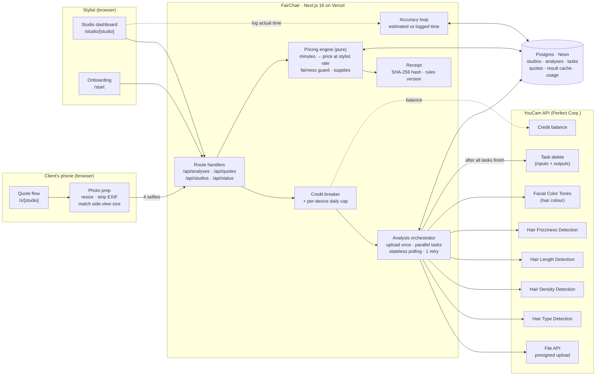
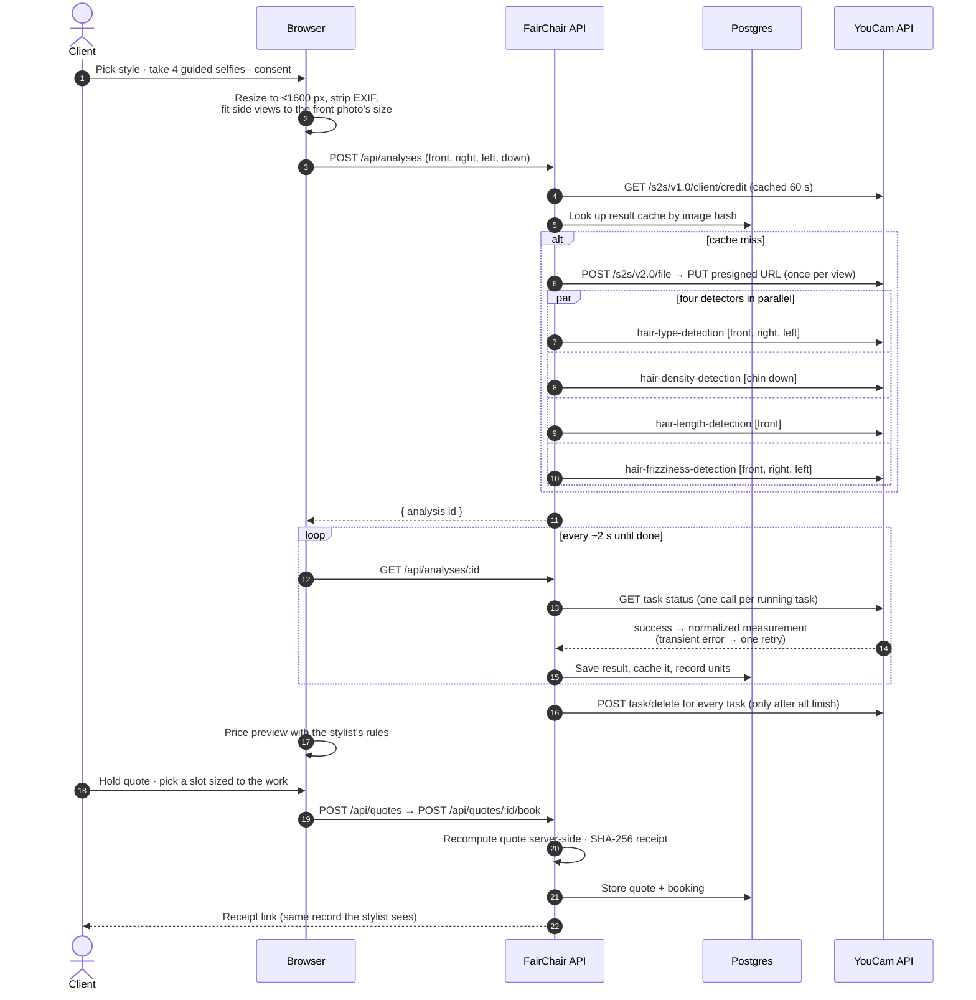

# FairChair

**Honest quotes for textured hair, measured before anyone books.**

FairChair turns four client selfies into a line-item price, an appointment as long as the hair actually needs, and a supply list for braiders and extension stylists, using YouCam's hair type, density, length and frizz detection.

Built for the [YouCam API Skin AI & eCommerce VTO Hackathon](https://youcam-api-skin-ai-ecommerce.devpost.com/).

---

## The problem

Independent braiders publish "Knotless, mid-back: from $220" and then quote from a blurry DM selfie at 11 pm. The things that change the price and the time, **how long, how full, how coily and how frizzy the client's natural hair is**, are listed in every braider's FAQ and measured by nobody. On the day, fuller and longer hair means two extra hours, a "$50 more" conversation at the chair, and the next client waiting. Existing quote tools still make someone *type* the hair in.

## What FairChair does

1. **Measure.** The client takes four guided selfies. YouCam's hair detectors read curl pattern, density, natural length and frizz (plus hair colour for extension services).
2. **Price.** The stylist's own menu and hourly rate turn measured differences into minutes of chair time and a price range. Every line on the quote says which measurement caused it.
3. **Agree.** The client books a slot already sized to the work and pays a deposit; both sides keep the same hashed receipt.
4. **Learn.** After each appointment the stylist logs the real time; FairChair shows which of *their* rules is consistently off.

**Fair by design:** texture changes *time*, never the *rate*. A flat "+$25 for 4C" is a texture surcharge; FairChair won't apply it and offers the time-based equivalent instead.

**The one-screen demo:** *Same style. Two heads. Two honest quotes.* With real YouCam results, the curlier client is **not** the more expensive one; the fuller head is.

## How YouCam is used

| Decision FairChair makes | YouCam API | Endpoint |
|---|---|---|
| Stretch/detangle prep time, extension texture match | AI Hair Type Detection (1→4c, 9 bands) | `POST /s2s/v2.0/task/hair-type-detection` (front, right, left views) |
| Parting/feeding time, extension pack count | AI Hair Density Detection (0–3) | `POST /s2s/v2.0/task/hair-density-detection` (chin-down view) |
| Short-hair/long-hair time, extension length to order | AI Hair Length Detection (8 bands) | `POST /s2s/v2.0/task/hair-length-detection` (front view) |
| Smoothing prep time | AI Hair Frizziness Detection (4 grades) | `POST /s2s/v2.0/task/hair-frizziness-detection` (front, right, left) |
| Extension shade | AI Facial Color Tones Analyzer → `hair_color` | `POST /s2s/v2.0/task/skin-tone-analysis` |
| Photo upload, privacy clean-up | File API, Task delete | `POST /s2s/v2.0/file` → PUT, `POST /s2s/v2.0/task/delete` |

Integration details (all server-side; the key never reaches the browser):
- Four photos uploaded once each via presigned URLs; four detectors run **in parallel**; the client polls a stateless status endpoint (serverless-safe).
- **Result cache** keyed by image hash per feature, so the same photos never spend units twice.
- **Credit circuit-breaker** (reads `/s2s/v1.0/client/credit`) and a per-device daily cap protect the unit budget.
- One automatic retry on transient engine errors (errors cost no units).
- After *all* tasks finish, tasks and their input photos are deleted from YouCam (`task/delete`).
- Demo clients replay **recorded live YouCam responses** and are always labelled; nothing is presented as live that isn't.

Live-API findings (accuracy smoke test, determinism, latency, bugs found) are in [`docs/measurements.md`](docs/measurements.md).

## Architecture

### System



### One live quote



More detail: [`docs/architecture.md`](docs/architecture.md).

## Try it

- **Client:** `/s/amara-braids-demo`: pick a style, then use your own selfies (live) or a demo client (recorded).
- **Stylist:** `/studio/amara-braids-demo?key=demo`: requests, calendar, menu & rules (edit and watch the preview quote change), accuracy, share links.
- **Your own studio:** `/start`.

## Run locally

Requires Node 22+.

```bash
npm install
cp .env.example .env   # add YOUCAM_API_KEY
npm run dev            # http://localhost:3000 — uses embedded PGlite, no database setup
```

Other scripts:

```bash
npm test               # pricing engine, YouCam normalizers, accuracy, timezone tests
npm run youcam:check   # verifies the key and shows the unit balance (spends 0 units)
npm run spike          # the live accuracy spike (generates synthetic portraits; spends units)
```

## Deploy (Vercel)

1. Import the GitHub repo into Vercel.
2. Add a **Neon Postgres** database (Vercel → Storage → Neon); it sets `DATABASE_URL`. Migrations run automatically before each build.
3. Set environment variables: `YOUCAM_API_KEY`, `APP_SECRET` (long random string), optionally `CREDIT_RESERVE` and `LIVE_DAILY_CAP_PER_IP`.

## Stack

Next.js 16 (App Router) · React 19 · TypeScript · Tailwind CSS v4 · Drizzle ORM · Postgres (Neon; embedded PGlite locally) · Zod · Vitest.

## Honest limits

- Measurements are coarse bands, so quotes are ranges and the stylist can override with a reason the client sees.
- Hair length is measured as the hair hangs; curly/coily clients can add a *reported* stretched length, labelled as reported.
- Accuracy has been smoke-tested on synthetic portraits (see `docs/measurements.md`); a study on real, consented photos is next.
- FairChair measures appearance for pricing and scheduling. It does not assess hair or scalp health.

## Project documents

- [`research/`](research/): hackathon requirements, previous-winner analysis, idea bank (22 concepts), evidence register, product thesis, adversarial review
- [`docs/architecture.md`](docs/architecture.md), [`docs/business.md`](docs/business.md), [`docs/measurements.md`](docs/measurements.md)
- The YouCam upload/poll client pattern was adapted from the author's previous hackathon project (MirrorIQ); everything else was built new for this hackathon.
