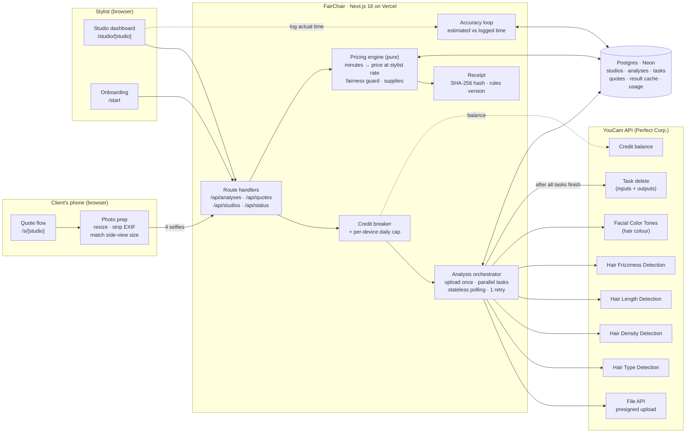
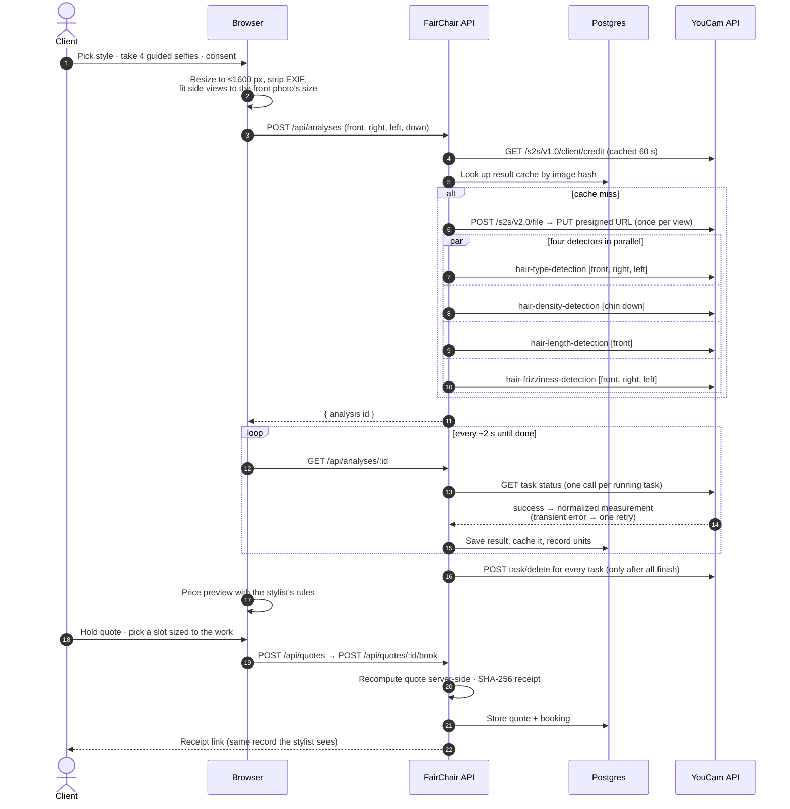

# FairChair — Architecture

_v1 — 2026-09-30_

## 1. Goals that shape the architecture
1. **Real, load-bearing YouCam integration** with correct async handling, and never a fake result presented as live.
2. **Protect 1,000 API units** through a 17-day judging window: caching, replay mode, and a credit circuit-breaker.
3. **Deterministic pricing**: the same measurements + the same rules always produce the same quote (unit-tested).
4. **Privacy by default**: photos are transient; measurements are the record.
5. **Zero-setup local dev; cheap production** (Vercel + Neon free tiers).

## 2. Stack
| Layer | Choice | Why |
|---|---|---|
| App | Next.js 16 (App Router), React 19, TypeScript | One deployable; server routes keep keys server-side; proven in MirrorIQ |
| Styling | Tailwind CSS v4, custom design tokens | Speed + a distinct brand |
| DB | Postgres via **Drizzle ORM**; **PGlite** (embedded Postgres) locally, **Neon** in production | Same SQL everywhere; no local setup |
| Hosting | Vercel | Instant judge URL, previews |
| Tests | Vitest (pricing engine, YouCam normalizers) | Pricing must be provably deterministic |
| Validation | Zod | Every API boundary |

## 3. Diagrams

### System architecture



### One live quote, end to end



## 4. YouCam integration
### Flow for one quote analysis
1. Browser resizes the photo (long side ≤1600 px, JPEG q≈0.88) → `POST /api/analyses` (multipart).
2. Server computes `sha256(image)`. **Cache hit** on `(hash, feature)` in `result_cache` → reuse; no units spent.
3. Otherwise upload once to YouCam (`/s2s/v2.0/file` + PUT) → `file_id`, reused for all features.
4. Start tasks **in parallel**: `hair-type-detection`, `hair-density-detection`, `hair-length-detection`, `hair-frizziness-detection` (+ `skin-tone-analysis` only for extension services).
5. Client polls `GET /api/analyses/:id` every 2 s; each poll performs **at most one** upstream GET per pending task (stateless, serverless-safe, no long-running functions). Webhook, if configured, marks tasks done sooner.
6. On success: normalize → store → write `result_cache` → `POST /s2s/v2.0/task/delete` (privacy).
7. On error: map YouCam error codes to user-facing guidance (`error_no_face` → "We need your face in frame so we can read length"; `error_multiple_people`; `error_below_min_image_size`; `error_face_position_invalid`). Errors cost no units; one automatic retry for transient failures.

### Rate limits and resilience
- 250 req / 300 s per IP and per token → global token bucket (in DB) ~0.7 req/s sustained; exponential backoff on 429.
- Per-request timeout 30 s; polling budget 90 s per task, then "still processing" state with resume.

### Credit protection
- `credits.ts` reads balance (cached 60 s). Below **reserve threshold** (default 200 units) → live analysis disabled for anonymous traffic; judge path switches to replay with a visible "Replayed result, recorded live on <date>" badge.
- Per-IP daily cap for live analyses (default 3).
- `usage_ledger` records units per feature per request (from the documented unit table) for the cost dashboard.

### Replay (judge mode)
- `replay.ts` serves **recorded real YouCam responses** captured from live runs on demo images, stored as JSON fixtures with capture date + request metadata. Never synthesized by hand. The UI always labels replayed results.

## 5. Pricing engine (`lib/pricing`)
Pure functions; no I/O; 100% unit-tested.
```
quote(service, options, measurements, studioRules) → {
  priceRange: [low, high], durationMin, lines: QuoteLine[], supplies: Supply[], warnings: Warning[]
}
QuoteLine = { label, minutes, price, because: MeasurementRef | OptionRef }
```
- **Base:** chosen style × size × target length (stylist's menu).
- **Measured adjustments:** density grade → minutes (+ packs for extensions); length band → minutes / short-hair rule; type band → prep minutes; frizz grade → prep minutes.
- **Time → price** at the stylist's hourly rate when "price by time" is on (default).
- **Fairness guard:** rule schema has no "price by curl type" field; importing/typing such a rule produces a warning with a one-click conversion to prep minutes.
- **Confidence:** if any measurement is missing/low-confidence, the range widens and the line says "not measured".
- Rule version hash stored with each quote → receipts are reproducible.

## 6. Data model (Drizzle)
| Table | Key fields |
|---|---|
| `studios` | id, slug, name, city, hourly_rate, currency, deposit_pct, admin_token_hash, created_at |
| `services` | id, studio_id, template, name, base_prices (json by size×length), base_minutes, rules (json), active |
| `analyses` | id, studio_id, image_sha256, status, source (`live`/`replay`), created_at, deleted_upstream_at |
| `analysis_tasks` | id, analysis_id, feature, youcam_task_id, status, result (json), error, units |
| `quotes` | id, studio_id, service_id, analysis_id, options (json), measurements (json), result (json), rules_hash, receipt_hash, client_name, status |
| `bookings` | id, quote_id, start_at, duration_min, deposit_cents, actual_minutes |
| `result_cache` | image_sha256, feature, result (json), created_at |
| `usage_ledger` | id, feature, units, source, created_at |

## 7. Accounts and auth
- **Clients:** no account. A quote has an unguessable ID + receipt link.
- **Stylists (MVP):** create a studio → receive a private admin link (capability URL, token hashed in DB) + optional email. Production path: add passwordless email (Auth.js) without schema changes.
- **Judge mode:** seeded demo studio "Amara Braids & Co. (demo)" with an open admin view; clearly marked as demo data.

## 8. Privacy and security
- Consent screen before capture (YouCam ToS §3.4). Plain language: what's measured, where it goes, how long it's kept.
- Photos: in memory on our server → YouCam presigned upload → `task/delete` after results. Receipt photos only if the client opts in; stored as downscaled JPEG, auto-expire in 90 days.
- API key only in server env; `server-only` import guard on `lib/youcam`.
- Webhook signature verification (Standard Webhooks HMAC-SHA256, timestamp tolerance 5 min).
- Input validation (Zod), file type/size limits (jpg/png, ≤8 MB), per-IP rate limits.
- No face images sent to any non-YouCam AI service.

## 9. Error handling
Every state has a designed screen: capture guidance, uploading, analysing (per-feature progress from real task states), partial success (some features failed → quote with wider range and "not measured" lines), full failure (retake guidance by error code), credit-exhausted (replay notice), rate-limited.

## 10. Analytics (privacy-light)
First-party events only (no third-party trackers): quote_started, capture_ok, analysis_done (latency, source), quote_viewed, booking_created, override_used. Stored in DB; stylist dashboard shows funnel + estimate accuracy (estimated vs actual minutes).

## 11. Deployment
- Vercel project; env: `YOUCAM_API_KEY`, `YOUCAM_BASE_URL`, `YOUCAM_WEBHOOK_SECRET` (optional), `DATABASE_URL` (Neon), `CREDIT_RESERVE`, `LIVE_DAILY_CAP_PER_IP`.
- Migrations via drizzle-kit; seed script for the demo studio + replay fixtures.

## 12. Cost model
| Item | Units | Notes |
|---|---|---|
| Hair type | 2 | |
| Hair density | 1 | |
| Hair length | 2 | |
| Hair frizz | 2 | |
| **Core quote analysis** | **7** | cached by image hash |
| Hair colour hex (extensions only) | 20 | skin-tone-analysis; optional; consider local fallback |
| Try-on preview | 1–2 | hair-ext / hair-style / hair-color |
| Budget | 1,000 (+≤1,000 share bonus) | ≈ 110 full quotes incl. try-on; reserve 200 for judging |
_Dollar price per unit to be confirmed from yce.perfectcorp.com/ai-api/api-pricing._

## 13. Store widget ("Find my match") — added 2026-10-01
- **Data:** `shops` (store, storefront domain, product in Shopify product-JSON shape, match settings, admin key hash) and `assets` (stylist portfolio photos, base64 text for driver portability).
- **Onboarding:** `POST /api/shops` fetches `https://<store>/products/<handle>.js` server-side with SSRF guards (https only, public DNS only, no redirects, 8 s timeout, 2 MB cap) and stores the normalized product.
- **Flow:** shopper chooses length + colour family → the same four-selfie capture (`/api/analyses` with `shop`, features: type, density, length) → `matchExtensions()` (pure, tested) picks the variant and pack count → `/api/tryon-ext` runs YouCam `hair-ext` with the template for the matched length → **Add to cart** = Shopify cart permalink `/cart/<variant>:<qty>` on the store's own domain.
- **Embedding:** `/embed/m/<store>` (iframe, auto-resizing via `postMessage`) loaded by `public/embed.js` from a `data-fairchair-shop` element — e.g. a Shopify Custom Liquid block.
- **Guided capture:** YouCam JS Camera Kit (`hairlength` → `hairtype` → `hairdensity`) in the browser; the step-back shot (`full` view) feeds length when present.
